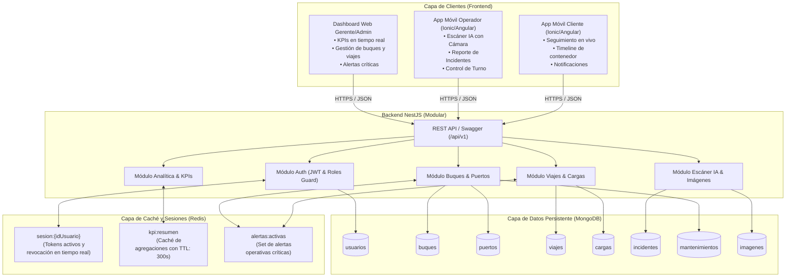

# Arquitectura del Sistema — NaviPort (OceanTrack)

Plataforma integral basada en arquitectura NoSQL (**MongoDB + Redis**) para la gestión de flota naviera y rastreo de importaciones marítimas desde China (Shanghai - Terminal Yangshan) y EE.UU. (Miami) hacia Ecuador (Guayaquil - Puerto Marítimo).

---

## 1. Diagrama de Arquitectura Global



---

## 2. Roles del Sistema y Matriz de Acceso

| Rol | Entorno Principal | Capacidades Clave |
| :--- | :--- | :--- |
| **`cliente`** | App Móvil (Ionic) | Visualiza sus cargas activas, búsqueda de contenedores por código, timeline interactivo de eventos, consulta de fechas estimadas y notificaciones push. |
| **`operador`** | App Móvil (Ionic) | Escáner de contenedores con cámara (IA), lectura óptica de dígitos, detección de precintos dañados, registro de incidentes en puerto con fotografía de evidencia. |
| **`gerente`** | Web Dashboard / Móvil | Visualización de KPIs operacionales (puntualidad, toneladas transportadas), monitor de alertas urgentes, reportes agregados. |
| **`admin`** | Web Dashboard | Control maestro de usuarios (activación/suspensión inmediata vía Redis), registro de buques, puertos y programación de rutas y viajes. |

---

## 3. Modelo de Datos MongoDB (Mongoose Schemas)

### 3.1 Colección: `usuarios`
```typescript
{
  _id: ObjectId,
  nombre: string,           // Ej: "Gary Industries" o "Javier Mendoza"
  correo: string,           // Único, indexado
  password_hash: string,
  rol: 'cliente' | 'operador' | 'gerente' | 'admin',
  detallesPerfil: {         // Incrustado según el rol
    empresa?: string,       // Si rol === 'cliente'
    ruc?: string,           // Si rol === 'cliente'
    turno?: string,         // Si rol === 'operador' (ej: "Matutino")
    idEmpleado?: string     // Si rol === 'operador'
  },
  preferencias: {
    notificacionesPush: boolean,
    modoOscuro: boolean
  },
  activo: boolean           // Si pasa a false, la sesión en Redis se destruye de inmediato
}
```

### 3.2 Colección: `puertos`
```typescript
{
  _id: ObjectId,
  nombre: string,           // Ej: "Puerto Marítimo de Guayaquil", "Terminal Yangshan"
  pais: string,             // "ECU", "CHN", "USA"
  ciudad: string,           // "Guayaquil", "Shanghai", "Miami"
  ubicacion: {              // GeoJSON para cálculo de rutas y render en mapa
    type: "Point",
    coordinates: [number, number] // [longitud, latitud] Ej: [-79.9, -2.2]
  }
}
```

### 3.3 Colección: `buques`
```typescript
{
  _id: ObjectId,
  nombre: string,           // Ej: "Maersk Horizon"
  imo: string,              // Identificador internacional único del barco
  tipo: string,             // "Portacontenedores", "Granelero", etc.
  capacidadToneladas: number,
  bandera: string,          // Ej: "Panamá", "Liberia"
  estado: 'activo' | 'mantenimiento' | 'inactivo'
}
```

### 3.4 Colección: `viajes`
```typescript
{
  _id: ObjectId,
  codigo: string,           // Ej: "V-2026-014", "#BU-1234XYZ"
  buqueId: ObjectId,        // Ref -> buques
  origenId: ObjectId,       // Ref -> puertos
  destinoId: ObjectId,      // Ref -> puertos
  fechas: {
    salida: Date,
    llegadaEstimada: Date,
    llegadaReal?: Date
  },
  estado: 'programado' | 'en_ruta' | 'finalizado' | 'retrasado',
  ultimaPosicion: {         // GeoJSON (Pin amarillo en mapa de la app)
    type: "Point",
    coordinates: [number, number]
  },
  resumenCarga: {           // Incrustado para evitar joins costosos en Dashboard
    contenedores: number,   // Ej: 120
    toneladas: number       // Ej: 2400
  }
}
```

### 3.5 Colección: `cargas`
```typescript
{
  _id: ObjectId,
  viajeId: ObjectId,        // Ref -> viajes
  clienteId: ObjectId,      // Ref -> usuarios (Filtro clave para aislamiento y seguridad)
  codigoContenedor: string, // Ej: "#CN-9823"
  tipo: 'Seco' | 'Refrigerado',
  pesoToneladas: number,
  historialEventos: [       // Array incrustado que genera el Timeline vertical
    {
      estado: string,       // "Recogido en fábrica", "En patio", "A bordo", "En tránsito", "En aduana"
      fecha: Date,
      ubicacion: string     // "Terminal Yangshan (CHN)"
    }
  ]
}
```

### 3.6 Colección: `incidentes`
```typescript
{
  _id: ObjectId,
  viajeId: ObjectId,        // Ref -> viajes
  buqueId: ObjectId,        // Ref -> buques
  operadorId: ObjectId,     // Ref -> usuarios
  tipo: 'retraso' | 'averia' | 'clima',
  descripcion: string,      // Ej: "Precinto roto / Avería en contenedor refrigerado"
  gravedad: 'alta' | 'media' | 'baja',
  fecha: Date
}
```

### 3.7 Colección: `imagenes` (Evidencia y Procesamiento IA)
```typescript
{
  _id: ObjectId,
  entidadId: ObjectId,      // Ref -> incidenteId o cargaId
  tipoEntidad: 'incidente' | 'carga',
  rutaArchivo: string,      // URL de la imagen en almacenamiento seguro o S3
  resultadoIA: {
    codigoLeido: string,    // Ej: "#CN-9823"
    dañosDetectados: boolean,
    confianza: number       // Ej: 85 (porcentaje)
  }
}
```

### 3.8 Colección: `mantenimientos`
```typescript
{
  _id: ObjectId,
  buqueId: ObjectId,        // Ref -> buques
  tipo: 'preventivo' | 'correctivo',
  fechas: {
    programada: Date,
    real?: Date
  },
  estado: 'pendiente' | 'completado'
}
```

---

## 4. Estrategia de Redis en Detalle

### 4.1 Caché de KPIs (Dashboard del Gerente)
- **Clave**: `kpi:resumen`
- **Tipo de Dato**: `String` (JSON serializado) o `Hash`
- **TTL**: `300` segundos (5 minutos)
- **Flujo de Ejecución**:
  ```text
  GET /api/v1/kpis/resumen
     ├── 1. Consultar clave 'kpi:resumen' en Redis.
     ├── 2. ¿Existe? -> Retornar inmediatamente (<5ms).
     └── 3. ¿No existe / Expiró? ->
               - Ejecutar Pipeline de Agregación en MongoDB ($group, $avg, $sum).
               - Guardar resultado en Redis con SETEX kpi:resumen 300 '{...}'.
               - Retornar respuesta al cliente.
  ```

### 4.2 Gestión de Alertas Críticas
- **Clave**: `alertas:activas`
- **Tipo de Dato**: `Set` (`SADD`, `SMEMBERS`, `SREM`)
- **Valores**: Strings únicos con identificador de entidad:
  - `"viaje_retrasado:V-2026-014"`
  - `"mantenimiento_vencido:IMO-9876543"`
- **Flujo de Alerta**:
  Cuando un operador reporta un incidente grave o un viaje cambia a `retrasado`, el backend guarda en MongoDB e inserta el evento en el Set de Redis (`SADD alertas:activas viaje_retrasado:V-2026-014`), permitiendo al Dashboard reflejar la alerta instantáneamente.

### 4.3 Control de Accesos y Revocación en Tiempo Real
- **Clave**: `sesion:{idUsuario}` (Ej: `sesion:652b4c89f1a2`)
- **Tipo de Dato**: `Hash`
- **Campos**:
  ```text
  token: "eyJhbGciOi..."
  rol: "operador"
  activo: "true"
  ```
- **Flujo de Seguridad**:
  En cada petición protegida por `JwtAuthGuard`, el backend no solo verifica la firma criptográfica del JWT, sino que consulta si la clave `sesion:{idUsuario}` existe en Redis. Si el administrador desactiva a un usuario en MongoDB, la API elimina la clave de Redis (`DEL sesion:{idUsuario}`), revocando el acceso en tiempo real sin esperar a que el JWT expire.
