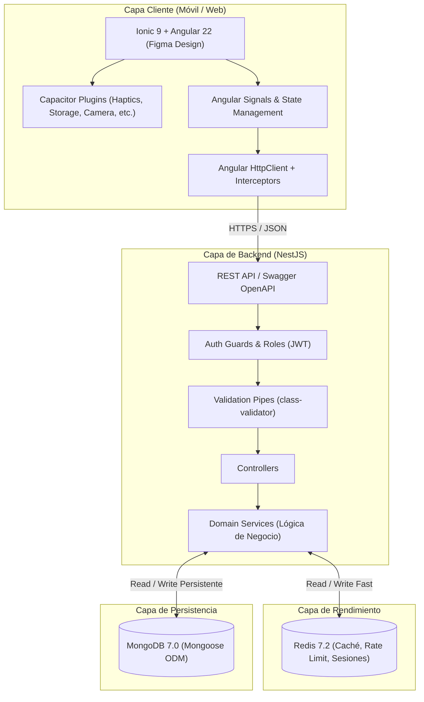

# Arquitectura del Sistema — Naviport

Este documento describe la arquitectura global, patrones de diseño, flujo de datos y decisiones técnicas implementadas en **Naviport**.

---

## 1. Diagrama de Alto Nivel



---

## 2. Frontend: Ionic + Angular

### 2.1 Principios Arquitectónicos
- **Standalone Components**: Componentes autónomos de Angular para modularidad y carga optimizada.
- **Signals y Reactividad Moderna**: Manejo de estado local y compartido con `signal()`, `computed()` y `effect()`.
- **Enfoque Mobile-First**: Adaptación pixel-perfect desde Figma mediante variables CSS (`src/theme/variables.scss`).
- **Encapsulación de Plugins Nativos**: Ningún componente consume Capacitor directamente; se utilizan servicios puente (ej. `NativeStorageService`, `CameraService`, `DeviceService`).

### 2.2 Estructura de Directorios Propuesta en `frontend_navi/src/app`
```text
src/app/
├── core/                  # Singleton: servicios globales, interceptores, guards
│   ├── guards/            # AuthGuard, RoleGuard
│   ├── interceptors/      # AuthInterceptor, ErrorInterceptor
│   └── services/          # Storage, Logger, Theme
├── shared/                # Componentes reutilizables, directivas, pipes
│   ├── components/        # Botones personalizados, headers, modales
│   └── pipes/
├── features/              # Módulos o dominios funcionales (Lazy-loaded)
│   ├── auth/              # Login, registro, recuperación
│   ├── home/              # Dashboard / Pantalla principal
│   └── profile/           # Perfil de usuario, configuraciones
└── theme/                 # Estilos globales y paleta de Figma
```

---

## 3. Backend: NestJS Modular

### 3.1 Estructura por Dominios (DDD Ligero)
Cada entidad funcional se aísla en su propio módulo:
```text
backend_navi/src/
├── app.module.ts
├── main.ts
├── common/                # Elementos transversales
│   ├── decorators/        # @CurrentUser(), @Public()
│   ├── filters/           # AllExceptionsFilter
│   ├── guards/            # JwtAuthGuard, RolesGuard
│   └── interceptors/      # TransformResponseInterceptor, LoggingInterceptor
├── config/                # Carga de variables de entorno (MongoDB, Redis, JWT)
└── modules/               # Módulos de dominio
    ├── auth/              # Autenticación, JWT, hashing argon2/bcrypt
    ├── users/             # Gestión de usuarios y perfiles
    └── ...                # Módulos específicos del negocio (a definir)
```

---

## 4. Estrategia de Base de Datos y Caché

### 4.1 MongoDB (Mongoose)
- **Rol**: Almacén persistente principal para datos estructurados del dominio (usuarios, transacciones, registros de actividad).
- **Convenciones**:
  - Índices explícitos en campos consultados con frecuencia (`email`, `status`, `createdAt`).
  - Timestamps automáticos (`timestamps: true`).
  - Esquemas definidos con `@Schema()` y tipados estrictos con TypeScript.

### 4.2 Redis
- **Rol**: Almacenamiento clave-valor ultrarrápido en memoria RAM.
- **Casos de Uso en Naviport**:
  1. **Caché de Consultas Frecuentes**: Respuestas de endpoints de alta lectura con tiempo de expiración (TTL).
  2. **Listas Negras de Tokens / Sesiones**: Revocación instantánea de JWTs al cerrar sesión.
  3. **Rate Limiting**: Protección contra abuso de endpoints sensibles (login, envío de códigos).
  4. **Patrón Cache-Aside**:
     ```text
     Consulta -> ¿Existe en Redis?
       SI -> Retornar dato de Redis (latencia < 5ms)
       NO -> Consultar MongoDB -> Guardar en Redis con TTL -> Retornar dato
     ```

---

## 5. Seguridad y Comunicación

1. **Autenticación**: JSON Web Tokens (JWT) transmitidos en el encabezado `Authorization: Bearer <token>`.
2. **Validación de Entrada**: `ValidationPipe` en NestJS rechaza automáticamente payloads que contengan propiedades no declaradas en los DTOs (`whitelist: true`, `forbidNonWhitelisted: true`).
3. **CORS**: Habilitado en desarrollo para el puerto de Ionic (`http://localhost:8100`).
4. **Documentación Swagger**: Disponible en `/api/docs` con esquema OpenAPI para autogenerar o verificar interfaces entre frontend y backend.
