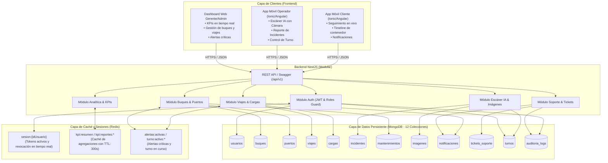

# Arquitectura del Sistema — NaviPort (OceanTrack)

Plataforma integral basada en arquitectura NoSQL (**MongoDB + Redis**) para la gestión de flota naviera y rastreo de importaciones marítimas desde China (Shanghai - Terminal Yangshan) y EE.UU. (Miami) hacia Ecuador (Guayaquil - Puerto Marítimo).

---

## 1. Diagrama de Arquitectura Global



---

## 2. Roles del Sistema y Matriz de Acceso

| Rol | Entorno Principal | Capacidades Clave |
| :--- | :--- | :--- |
| **`cliente`** | App Móvil (Ionic) | Visualiza sus cargas activas, búsqueda de contenedores por código, timeline interactivo de eventos, consulta de fechas estimadas y notificaciones push. |
| **`operador`** | App Móvil (Ionic) | Escáner de contenedores con cámara (IA), lectura óptica de dígitos, detección de precintos dañados, registro de incidentes en puerto con fotografía de evidencia. |
| **`gerente`** | Web Dashboard / Móvil | Visualización de KPIs operacionales (puntualidad, toneladas transportadas), monitor de alertas urgentes, reportes agregados. |
| **`admin`** | Web Dashboard | Control maestro de usuarios (activación/suspensión inmediata vía Redis), registro de buques, puertos y programación de rutas y viajes. |

> Ver el diagrama completo de flujo end-to-end por rol en [FLUJO_ROLES_DIAGRAMA.md](docs/FLUJO_ROLES_DIAGRAMA.md).

---

## 3. Modelo de Datos MongoDB (Mongoose Schemas)

### 3.1 Colección: `usuarios`
```typescript
{
  _id: ObjectId,
  nombre: string,           // Ej: "Gary Industries" o "Javier Mendoza"
  correo: string,           // Único, indexado
  password_hash: string,
  avatarUrl?: string,
  rol: 'cliente' | 'operador' | 'gerente' | 'admin',
  detallesPerfil: {         // Incrustado según el rol
    empresa?: string,       // Si rol === 'cliente'
    ruc?: string,           // Si rol === 'cliente'
    direccionLegal?: string,// Si rol === 'cliente'
    telefono?: string,      // Si rol === 'cliente'
    turno?: string,         // Si rol === 'operador' (ej: "Matutino")
    horarioTurno?: string,  // Ej: "08:00 - 16:00"
    turnoActivo?: boolean,  // Estado del turno del operador
    idEmpleado?: string     // Si rol === 'operador'
  },
  preferencias: {
    notificacionesPush: boolean,
    modoOscuro: boolean,
    idioma: 'es' | 'en'     // Idioma e informes portuarios
  },
  activo: boolean           // Si pasa a false, la sesión en Redis se destruye de inmediato
}
```

### 3.2 Colección: `puertos`
```typescript
{
  _id: ObjectId,
  nombre: string,           // Ej: "Puerto Marítimo de Guayaquil", "Terminal Yangshan"
  pais: string,             // "ECU", "CHN", "USA"
  ciudad: string,           // "Guayaquil", "Shanghai", "Miami"
  ubicacion: {              // GeoJSON con índice 2dsphere para cálculo de rutas y mapa
    type: "Point",
    coordinates: [number, number] // [longitud, latitud] Ej: [-79.9, -2.28]
  }
}
```

### 3.3 Colección: `buques`
> Índice compuesto: `{ estado: 1, estadoOperativo: 1 }`
```typescript
{
  _id: ObjectId,
  nombre: string,           // Ej: "Maersk Horizon", "MSC Irina"
  imo: string,              // Identificador internacional único del barco (indexado)
  tipo: string,             // "Portacontenedores", "Granelero", "Refrigerado"
  capacidadToneladas: number,
  bandera: string,          // Ej: "Panamá", "Liberia"
  capitan: string,          // Ej: "Luis Andrade"
  estado: 'activo' | 'mantenimiento' | 'inactivo',
  estadoOperativo: 'en_ruta' | 'en_puerto' | 'retraso' | 'mantenimiento' | 'inactivo'
}
```

### 3.4 Colección: `viajes`
> Índice compuesto: `{ estado: 1, 'fechas.salida': -1 }`
```typescript
{
  _id: ObjectId,
  codigo: string,           // Ej: "V-2026-014", "#BU-1234XYZ" (único, indexado)
  buqueId: ObjectId,        // Ref -> buques
  origenId: ObjectId,       // Ref -> puertos
  destinoId: ObjectId,      // Ref -> puertos
  fechas: {
    salida: Date,
    llegadaEstimada: Date,
    llegadaReal?: Date
  },
  estado: 'programado' | 'en_ruta' | 'finalizado' | 'retrasado',
  ultimaPosicion: {         // GeoJSON (Pin amarillo en mapa de la app)
    type: "Point",
    coordinates: [number, number]
  },
  velocidadNudos: number,   // Ej: 21.4
  capitanAsignado?: string,
  resumenCarga: {           // Incrustado para evitar joins costosos en Dashboard
    contenedores: number,   // Ej: 120
    toneladas: number       // Ej: 2400
  },
  finanzas: {               // Incrustado para analítica de Reportes Gerenciales
    ingresosEstimadosUSD: number,
    costoOperativoUSD: number
  }
}
```

### 3.5 Colección: `cargas`
> Índice compuesto: `{ clienteId: 1, viajeId: 1 }`
```typescript
{
  _id: ObjectId,
  viajeId: ObjectId,        // Ref -> viajes (indexado)
  clienteId: ObjectId,      // Ref -> usuarios (indexado - Filtro clave para aislamiento)
  codigoContenedor: string, // Ej: "#CN-9823" (único, indexado)
  tipo: 'Seco' | 'Refrigerado',
  pesoToneladas: number,
  numeroPrecinto?: string,  // Ej: "#MSK-4409"
  valorFleteUSD: number,
  manifiestoAduanero?: {
    numeroDocumento: string,// Ej: "BL-CN-9823-2026"
    fechaEmision: Date,
    partidaArancelaria: string,
    estadoAduana: 'pendiente' | 'declarado' | 'liberado'
  },
  historialEventos: [       // Array incrustado que genera el Timeline vertical
    {
      estado: string,       // "Recogido en fábrica", "En patio", "A bordo", "En tránsito"
      fecha: Date,
      ubicacion: string,    // "Terminal Yangshan (CHN)"
      descripcion?: string, // Detalle operativo por hito
      registradoPor?: ObjectId, // Ref -> usuarios (operador)
      completado?: boolean
    }
  ]
}
```

### 3.6 Colección: `incidentes`
> Índice compuesto: `{ estado: 1, gravedad: 1, fecha: -1 }`
```typescript
{
  _id: ObjectId,
  viajeId: ObjectId,        // Ref -> viajes (indexado)
  buqueId: ObjectId,        // Ref -> buques (indexado)
  operadorId: ObjectId,     // Ref -> usuarios
  codigoContenedor?: string,// Ej: "#CN-7741"
  tipo: 'retraso' | 'averia' | 'clima',
  descripcion: string,      // Ej: "Precinto roto / Avería en contenedor refrigerado"
  gravedad: 'alta' | 'media' | 'baja',
  estado: 'abierto' | 'en_revision' | 'resuelto',
  resueltoPor?: ObjectId,   // Ref -> usuarios (gerente/admin)
  fechaResolucion?: Date,
  fecha: Date
}
```

### 3.7 Colección: `imagenes` (Evidencia y Procesamiento IA)
> Índice compuesto: `{ operadorId: 1, createdAt: -1 }`
```typescript
{
  _id: ObjectId,
  entidadId: ObjectId,      // Ref -> incidenteId o cargaId (indexado)
  tipoEntidad: 'incidente' | 'carga',
  operadorId?: ObjectId,    // Ref -> usuarios (indexado)
  viajeId?: ObjectId,       // Ref -> viajes
  buqueNombre?: string,     // Ej: "Maersk Horizon"
  observaciones?: string,
  rutaArchivo: string,      // URL de la imagen en almacenamiento (/uploads/...)
  resultadoIA: {
    codigoLeido: string,    // Ej: "#CN-9823"
    dañosDetectados: boolean,
    confianza: number,      // Ej: 85 (porcentaje)
    estadoSello?: 'ok' | 'sello_roto' | 'averia'
  }
}
```

### 3.8 Colección: `mantenimientos`
```typescript
{
  _id: ObjectId,
  buqueId: ObjectId,        // Ref -> buques (indexado)
  tipo: 'preventivo' | 'correctivo',
  descripcion?: string,
  costoUSD: number,
  responsable?: string,
  fechas: {
    programada: Date,
    real?: Date
  },
  estado: 'pendiente' | 'completado'
}
```

### 3.9 Colección: `notificaciones`
> Índices compuestos: `{ usuarioId: 1, leida: 1, createdAt: -1 }` y `{ rolDestino: 1, leida: 1, createdAt: -1 }`
```typescript
{
  _id: ObjectId,
  usuarioId?: ObjectId,     // Ref -> usuarios (destinatario específico)
  rolDestino?: 'cliente' | 'operador' | 'gerente' | 'admin',
  tipo: 'retraso' | 'arribo_proximo' | 'evento_timeline' | 'incidente' | 'escaner' | 'turno' | 'soporte' | 'sistema',
  titulo: string,
  mensaje: string,
  codigoContenedor?: string,
  referenciaId?: string,
  leida: boolean,
  fechaLectura?: Date
}
```

### 3.10 Colección: `tickets_soporte`
> Índices compuestos: `{ usuarioId: 1, estado: 1, createdAt: -1 }` y `{ estado: 1, prioridad: 1 }`
```typescript
{
  _id: ObjectId,
  codigo: string,           // Único, Ej: "TKT-2026-001"
  usuarioId: ObjectId,      // Ref -> usuarios
  rolUsuario: string,
  tipo: 'agente_aduanas' | 'supervisor' | 'fallo_app' | 'consulta_general',
  asunto: string,
  mensaje: string,
  codigoContenedor?: string,
  prioridad: 'baja' | 'media' | 'alta',
  estado: 'abierto' | 'en_proceso' | 'resuelto' | 'cerrado',
  respuesta?: string,
  atendidoPor?: ObjectId,   // Ref -> usuarios (gerente/admin)
  fechaRespuesta?: Date
}
```

### 3.11 Colección: `turnos`
> Índice compuesto: `{ operadorId: 1, estado: 1, fechaInicio: -1 }`
```typescript
{
  _id: ObjectId,
  operadorId: ObjectId,     // Ref -> usuarios
  tipoTurno: string,        // Ej: "Matutino"
  horarioAsignado: string,  // Ej: "08:00 - 16:00"
  fechaInicio: Date,
  fechaFin?: Date,
  estado: 'activo' | 'finalizado',
  escaneosRealizados: number,
  incidentesReportados: number,
  observacionesCierre?: string
}
```

### 3.12 Colección: `auditoria_logs`
> Índice compuesto: `{ entidad: 1, accion: 1, fecha: -1 }`
```typescript
{
  _id: ObjectId,
  usuarioId: string,
  accion: string,           // Ej: "LOGIN", "SUSPENDER_USUARIO", "INICIAR_TURNO"
  entidad: string,          // Ej: "usuarios", "turnos", "incidentes", "tickets_soporte"
  entidadId?: string,
  detalle?: string,
  fecha: Date
}
```

---

## 4. Estrategia de Redis en Detalle

### 4.1 Caché de KPIs (Dashboard del Gerente)
- **Clave**: `kpi:resumen`
- **Tipo de Dato**: `String` (JSON serializado)
- **TTL**: `300` segundos (5 minutos)
- **Flujo de Ejecución**:
  ```text
  GET /api/v1/kpis/resumen
     ├── 1. Consultar clave 'kpi:resumen' en Redis.
     ├── 2. ¿Existe? -> Retornar inmediatamente (<5ms).
     └── 3. ¿No existe / Expiró? ->
               - Ejecutar Pipeline de Agregación en MongoDB ($group) y series de 6 meses.
               - Guardar resultado en Redis con SETEX kpi:resumen 300 '{...}'.
               - Retornar respuesta al cliente.
  ```

### 4.2 Caché de Reportes Financieros y por Ruta
- **Claves**: `kpi:reportes:mes`, `kpi:reportes:trimestre`, `kpi:reportes:anio`
- **Tipo de Dato**: `String` (JSON serializado)
- **TTL**: `300` segundos (5 minutos)
- **Invalidación**: Se eliminan en bloque junto con `kpi:resumen` cada vez que cambia un viaje, carga, buque, incidente o mantenimiento.

### 4.3 Gestión de Alertas Críticas
- **Clave**: `alertas:activas`
- **Tipo de Dato**: `Set` (`SADD`, `SMEMBERS`, `SREM`)
- **Valores**: Strings únicos con identificador de entidad:
  - `"viaje_retrasado:V-2026-014"`
  - `"mantenimiento_vencido:IMO-9876543"`
  - `"averia_detectada:#CN-9823"`
- **Flujo de Alerta**:
  Cuando un operador reporta un incidente grave o un viaje cambia a `retrasado`, el backend guarda en MongoDB e inserta el evento en el Set de Redis (`SADD alertas:activas ...`). Al resolverse el incidente o el viaje, se remueve con `SREM`.

### 4.4 Control de Accesos y Revocación en Tiempo Real
- **Clave**: `sesion:{idUsuario}` (Ej: `sesion:652b4c89f1a2`)
- **Tipo de Dato**: `Hash` (`HSET`, `HGETALL`, `EXPIRE`, `DEL`)
- **TTL**: `604800` segundos (7 días, alineado con el JWT)
- **Campos**: `token`, `rol`, `activo`.
- **Flujo de Seguridad**:
  En cada petición protegida por `JwtAuthGuard`, el backend verifica la firma criptográfica del JWT y valida que `sesion:{idUsuario}` exista en Redis, `activo === 'true'` y el `token` coincida. Si el administrador suspende al usuario o modifica su rol, la API ejecuta `DEL sesion:{idUsuario}` para revocar el acceso al instante.

### 4.5 Estado de Lectura de Notificaciones
- **Clave**: `notificaciones:leidas:{idUsuario}`
- **Tipo de Dato**: `Set` (`SADD`, `SMEMBERS`, `EXPIRE`)
- **TTL**: `2592000` segundos (30 días)
- **Propósito**: Persistir qué notificaciones fueron marcadas como leídas por cada cliente desde la campana de `Inicio`.

### 4.6 Protección contra Fuerza Bruta (Rate Limiting)
- **Clave**: `ratelimit:login:{correo}`
- **Tipo de Dato**: `String` / Contador atómico (`INCR`, `EXPIRE`, `DEL`)
- **TTL**: `60` segundos
- **Regla**: Máximo `5` intentos por ventana de 60 segundos; al superar el límite responde `429 Too Many Requests` y registra un evento de auditoría. Al hacer login exitoso se limpia con `DEL`.

### 4.7 Registro de Auditoría en Tiempo Real
- **Clave**: `auditoria:eventos`
- **Tipo de Dato**: `List` (`LPUSH`, `LTRIM 0 99`, `LRANGE`)
- **Propósito**: Mantener en caché rápida los últimos `100` eventos críticos de seguridad y operación, respaldados de forma permanente en la colección `auditoria_logs` de MongoDB.

### 4.8 Turno Activo de Operadores
- **Clave**: `turno:activo:{idOperador}`
- **Tipo de Dato**: `Hash` (`HSET`, `HGETALL`, `EXPIRE`, `DEL`)
- **TTL**: `43200` segundos (12 horas)
- **Campos**: `turnoId`, `tipoTurno`, `horarioAsignado`, `fechaInicio`.
- **Propósito**: Consultar instantáneamente el turno vigente de un empleado desde `Inicio Empleado` y sincronizar su cierre con la colección `turnos`.
