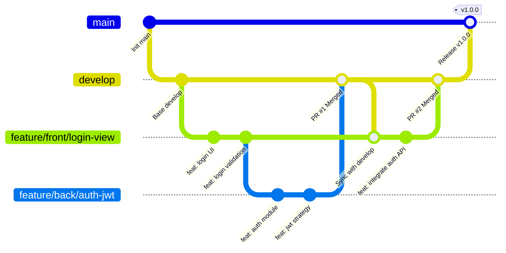

# Guía de Contribución y Flujo de Trabajo — Naviport

Para garantizar que los 3 integrantes del equipo (2 Frontend, 1 Backend) trabajen en armonía sin colisiones ni conflictos de Git, seguimos este flujo de trabajo estandarizado.

---

## 1. Modelo de Ramas (GitFlow Simplificado)



### Reglas Clave:
1. **`main`**: Rama de producción / entrega. **NUNCA** hacer commits directos ni pushes directos a `main`.
2. **`develop`**: Rama activa de integración. Todo trabajo nuevo converge aquí.
3. **Sub-ramas de desarrollo**: Se desprenden **siempre** de `develop`.

---

## 2. Nomenclatura de Ramas

| Prefijo | Propósito | Ejemplo |
| :--- | :--- | :--- |
| `feature/front/<nombre>` | Nueva funcionalidad de frontend | `feature/front/home-dashboard` |
| `feature/back/<nombre>` | Nuevo endpoint, servicio o módulo de backend | `feature/back/redis-cache` |
| `fix/front/<nombre>` | Corrección de bug en interfaz o cliente | `fix/front/input-validation` |
| `fix/back/<nombre>` | Corrección de bug en backend | `fix/back/jwt-expiration` |
| `chore/<nombre>` | Configuración, dependencias, CI/CD | `chore/update-docker` |

---

## 3. Convención de Commits (Conventional Commits)

Cada commit debe iniciar con un prefijo semántico en minúsculas:
- `feat:` Una nueva característica o pantalla para el usuario.
- `fix:` Corrección de un error o comportamiento inesperado.
- `refactor:` Cambio de código que no añade funcionalidad ni corrige un bug.
- `docs:` Modificación exclusivamente en archivos de documentación (`.md`).
- `style:` Cambios visuales/estéticos o de formato que no afectan la lógica.
- `test:` Adición o corrección de pruebas unitarias/e2e.
- `chore:` Actualización de dependencias, configuración de build o linters.

**Ejemplo de buen commit**:
```text
feat(auth): implement jwt token generation and redis session blacklist
feat(login): design login form with ionic inputs matching figma tokens
fix(nav): correct route redirect when token is expired
```

---

## 4. Ciclo de Vida de una Tarea (Paso a Paso)

### Paso 1: Actualizar `develop`
```bash
git checkout develop
git pull origin develop
```

### Paso 2: Crear tu sub-rama
```bash
git checkout -b feature/front/pantalla-perfil
# o si eres backend:
git checkout -b feature/back/modulo-perfil
```

### Paso 3: Desarrollar con asistencia de IA
Asegúrate de que el agente de IA siga las directrices de [`AGENTS.md`](./AGENTS.md).

### Paso 4: Validar antes del commit
- En Frontend: `npm run lint` y `npm run build`
- En Backend: `npm test` y `npm run build`

### Paso 5: Subir rama y abrir Pull Request (PR)
```bash
git push -u origin feature/front/pantalla-perfil
```
1. Abre un Pull Request en GitHub seleccionando como destino (`base`) la rama **`develop`**.
2. Completa la plantilla de PR.
3. Espera a que GitHub Actions pase los checks verdes de CI.
4. Solicita la revisión de un compañero de equipo.
5. Una vez aprobado, realiza el Merge (**Squash and merge** o **Merge commit** según preferencia).
