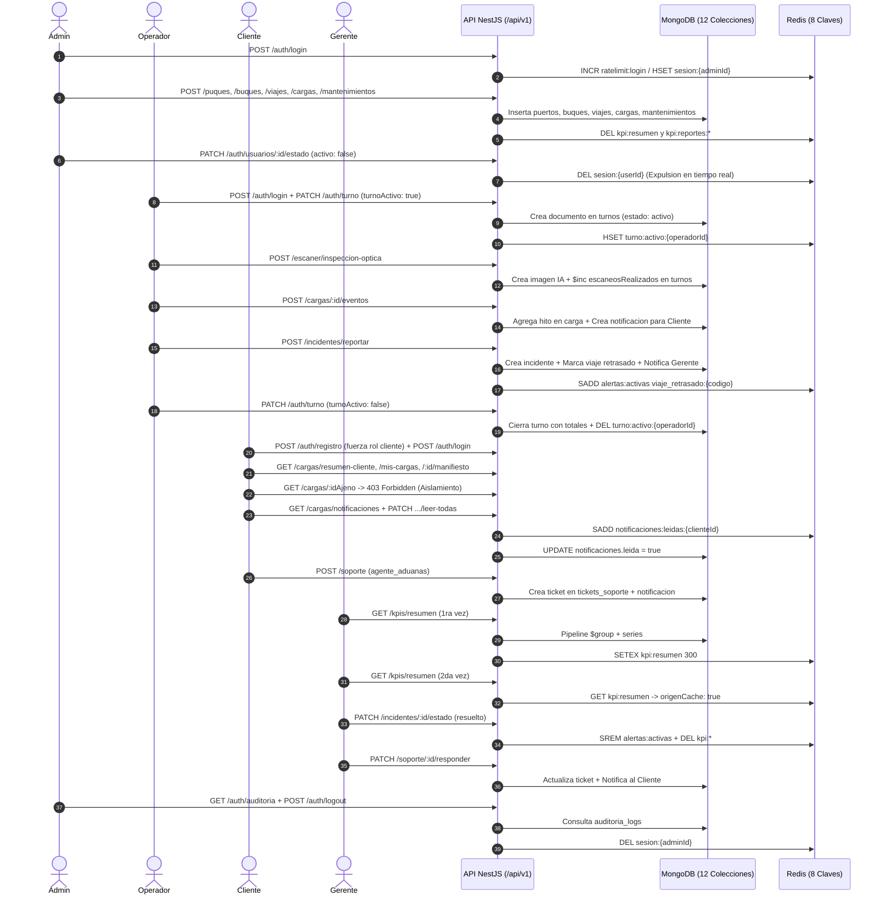

# Flujo Completo Multi-Rol End-to-End — NaviPort (OceanTrack)

Este documento describe el flujo operativo completo de los **4 roles del sistema** (`admin`, `operador`, `cliente`, `gerente`) conectado con los endpoints RESTful (`/api/v1`), las **12 colecciones de MongoDB** y las **8 estructuras de Redis**.

---

## 1. Diagrama de Flujo Maestro Multi-Rol (`flowchart TD`)

```mermaid
flowchart TD
    Start(["Inicio del Sistema NaviPort"]) --> A1["FASE 1: ADMIN - POST /auth/login"]

    subgraph F1 ["Fase 1: Administrador (Configuración y Control Maestro)"]
        A1 --> A2["POST /puertos (Crear/listar terminales)"]
        A2 --> A3["POST /buques + GET /buques/resumen-flota"]
        A3 --> A4["POST /viajes + PATCH /viajes/:id (Ruta y Finanzas)"]
        A4 --> A5["POST /cargas (Asignar contenedor al Cliente)"]
        A5 --> A6["POST /mantenimientos (Programar mantenimiento)"]
        A6 --> A7["POST /auth/usuarios (Crear usuario interno)"]
        A7 --> A8["PATCH /auth/usuarios/:id/estado (Suspender -> DEL sesion Redis)"]
        A8 --> A9["Reactivar usuario -> PATCH /auth/usuarios/:id/estado"]
    end

    A9 --> O1["FASE 2: OPERADOR - POST /auth/login"]

    subgraph F2 ["Fase 2: Operador / Empleado (Operación en Muelle)"]
        O1 --> O2["PATCH /auth/turno true (Crea en turnos + Redis turno:activo)"]
        O2 --> O3["POST /escaner/inspeccion-optica (Guarda imagenes + +1 escaneo en turno)"]
        O3 --> O4["GET /escaner/resumen-operador y /escaner/historial"]
        O4 --> O5["POST /cargas/:id/eventos (Timeline + Notificacion al Cliente)"]
        O5 --> O6["POST /incidentes/reportar (incidentes + viaje retrasado + Redis alertas)"]
        O6 --> O7["POST /soporte (Ticket a Supervisor)"]
        O7 --> O8["PATCH /auth/turno false + GET /auth/turnos/mi-historial"]
    end

    O8 --> C1["FASE 3: CLIENTE - POST /auth/registro y POST /auth/login"]

    subgraph F3 ["Fase 3: Cliente (Rastreo y Autogestión)"]
        C1 --> C2["GET /cargas/resumen-cliente (Home Cliente)"]
        C2 --> C3["GET /cargas/mis-cargas?estado=en_curso&q=..."]
        C3 --> C4["GET /cargas/:id y GET /cargas/:id/timeline"]
        C4 --> C5["GET /cargas/:id/manifiesto (Datos BL para PDF)"]
        C5 --> C6["Aislamiento 403 Forbidden al consultar carga ajena"]
        C6 --> C7["GET /cargas/notificaciones + PATCH leer / leer-todas"]
        C7 --> C8["PATCH /auth/perfil + PATCH /auth/preferencias"]
        C8 --> C9["POST /soporte (Agente Aduanas) + GET /soporte/mis-tickets"]
    end

    C9 --> G1["FASE 4: GERENTE - POST /auth/login"]

    subgraph F4 ["Fase 4: Gerente (Analítica, Alertas y Resolución)"]
        G1 --> G2["GET /kpis/resumen (1ra Miss -> MongoDB; 2da Hit -> Redis)"]
        G2 --> G3["GET /kpis/reportes?periodo=mes + exportar-csv"]
        G3 --> G4["GET /kpis/alertas-activas + DELETE /kpis/alertas-activas/:id"]
        G4 --> G5["PATCH /incidentes/:id/estado resuelto (Limpia alerta Redis)"]
        G5 --> G6["PATCH /mantenimientos/:id/estado completado (Reactiva buque)"]
        G6 --> G7["GET /soporte + PATCH /soporte/:id/responder (Notifica usuario)"]
        G7 --> G8["GET /auth/turnos (Supervision de turnos)"]
    end

    G8 --> A10["FASE 5: ADMIN - Cierre y Auditoría"]

    subgraph F5 ["Fase 5: Administrador (Auditoría, Limpieza y Logout)"]
        A10 --> A11["GET /auth/auditoria (Trazabilidad en auditoria_logs + Redis)"]
        A11 --> A12["DELETE /viajes/:id, /buques/:id, /puertos/:id, /mantenimientos/:id"]
        A12 --> A13["POST /auth/logout (DEL sesion:id -> 401 si reutiliza token)"]
    end
```

---

## 2. Diagrama de Secuencia Interactivo entre Roles (`sequenceDiagram`)

---

## 3. Matriz de Pasos de Verificación en Tiempo Real

| Fase | Paso | Rol | Endpoint | Qué valida en tiempo real |
| :--- | :--- | :--- | :--- | :--- |
| **0** | 0 | Público | `GET /health` | API viva (`200 OK`) |
| **1** | 1 | Admin | `POST /auth/login` | Token JWT válido + `sesion:{adminId}` en Redis |
| **1** | 2 | Admin | `POST /puertos`, `GET /puertos` | Creación GeoJSON `2dsphere` y listado |
| **1** | 3 | Admin | `POST /buques`, `GET /buques/resumen-flota`, `GET /buques/exportar-csv` | Creación, resumen agregado y CSV |
| **1** | 4 | Admin | `POST /viajes`, `PATCH /viajes/:id` | Programación y finanzas del viaje |
| **1** | 5 | Admin | `POST /cargas`, `GET /cargas` | Contenedor + manifiesto auto-generado |
| **1** | 6 | Admin | `POST /mantenimientos` | Programación y alerta si fecha vencida |
| **1** | 7 | Admin | `POST /auth/usuarios`, `PATCH /auth/usuarios/:id` | Creación interna y edición de perfil/rol |
| **1** | 8 | Admin | `PATCH /auth/usuarios/:id/estado` | Suspensión -> token revocado en Redis (`401`) y reactivación |
| **2** | 9 | Operador | `POST /auth/login`, `PATCH /auth/turno` (`true`) | Sesión y registro en `turnos` + `turno:activo:{id}` |
| **2** | 10 | Operador | `POST /escaner/inspeccion-optica` | Evidencia en `imagenes`, alerta Redis si hay daño, `+1` en `turnos` |
| **2** | 11 | Operador | `GET /escaner/resumen-operador`, `GET /escaner/historial` | Escaneos del día y últimos registros |
| **2** | 12 | Operador | `POST /cargas/:id/eventos` | Nuevo hito en timeline y notificación en `notificaciones` |
| **2** | 13 | Operador | `POST /incidentes/reportar` | Incidente `abierto`, viaje `retrasado`, alerta en Redis y notificación a Gerente |
| **2** | 14 | Operador | `POST /soporte` (`supervisor`) | Ticket en `tickets_soporte` |
| **2** | 15 | Operador | `PATCH /auth/turno` (`false`), `GET /auth/turnos/mi-historial` | Cierre del turno con conteo de escaneos/incidentes |
| **3** | 16 | Cliente | `POST /auth/registro` | Registro público fuerza `rol: 'cliente'` aunque envíe `'admin'` |
| **3** | 17 | Cliente | `POST /auth/login` | Sesión activa cliente |
| **3** | 18 | Cliente | `GET /cargas/resumen-cliente`, `GET /cargas/mis-cargas` | Métricas de Home y filtros `en_curso`/`completados` + `?q=` |
| **3** | 19 | Cliente | `GET /cargas/:id`, `GET /cargas/:id/timeline`, `GET /cargas/:id/manifiesto` | Detalle técnico, timeline vertical y manifiesto aduanero |
| **3** | 20 | Cliente | `GET /cargas/:idAjeno` | Seguridad: aislamiento `403 Forbidden` |
| **3** | 21 | Cliente | `GET /cargas/notificaciones`, `PATCH .../leer`, `PATCH .../leer-todas` | Persistencia de lectura en MongoDB + Redis |
| **3** | 22 | Cliente | `PATCH /auth/perfil`, `PATCH /auth/preferencias` | Actualiza empresa, dirección legal, idioma y modo oscuro |
| **3** | 23 | Cliente | `POST /soporte` (`agente_aduanas`), `GET /soporte/mis-tickets` | Ticket creado y visible para el cliente |
| **4** | 24 | Gerente | `POST /auth/login` | Sesión gerente activa |
| **4** | 25 | Gerente | `GET /kpis/resumen` (x2) | 1ra llamada `origenCache: false`; 2da llamada `origenCache: true` |
| **4** | 26 | Gerente | `GET /kpis/reportes?periodo=mes` (x2), `GET /kpis/reportes/exportar-csv` | Caché `kpi:reportes:mes` y exportación CSV |
| **4** | 27 | Gerente | `GET /kpis/alertas-activas`, `DELETE /kpis/alertas-activas/:id` | Lectura y limpieza manual en Redis `alertas:activas` |
| **4** | 28 | Gerente | `PATCH /incidentes/:id/estado` (`resuelto`) | Cierra incidente y limpia alertas en Redis |
| **4** | 29 | Gerente | `PATCH /mantenimientos/:id/estado` (`completado`) | Completa mantenimiento y reactiva buque |
| **4** | 30 | Gerente | `GET /soporte`, `PATCH /soporte/:id/responder`, `GET /auth/turnos` | Responde ticket (notifica cliente) y supervisa turnos |
| **5** | 31 | Admin | `GET /auth/auditoria` | Auditoría completa de todo el flujo en `auditoria_logs` |
| **5** | 32 | Admin | `DELETE` recursos de prueba + `POST /auth/logout` | Limpieza referencial e invalidación inmediata del token (`401`) |
